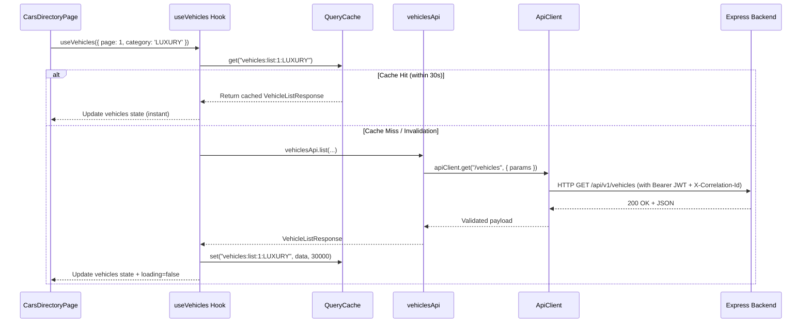

# Finovo AI Car Rental — Centralized Frontend API Architecture & Guidelines

**Document Version:** 1.0.0  
**Status:** Canonical Implementation  
**Date:** 2026-10-18  

---

## 1. Centralized API Architecture Overview

The Finovo frontend API communication is decoupled from UI presentation via a 4-tier pipeline:

$$\text{React Page / Component} \xrightarrow{\text{consume}} \text{Domain Hook} \xrightarrow{\text{call}} \text{Domain API Service} \xrightarrow{\text{execute}} \text{Shared ApiClient}$$



---

## 2. Core Capabilities of `ApiClient` (`src/api/client.ts`)

1. **Base URL Resolution:** Reads `VITE_API_URL` environment variable with fallback to `http://localhost:5000/api/v1`.
2. **Credential Management:** Automatically includes `credentials: 'include'` on all network requests so that HttpOnly session refresh cookies are securely transmitted with every request.
3. **Automatic Bearer Token Injection:** Injects `Authorization: Bearer <accessToken>` from memory / localStorage unless explicitly bypassed via `{ skipAuth: true }`.
4. **Concurrent Token Refresh Coordination:**
   - If an endpoint returns `401 Unauthorized` and is not an authentication route, the client engages a concurrency lock (`isRefreshing`).
   - Simultaneous in-flight requests are queued as subscriber callbacks rather than spamming multiple `/auth/refresh` requests.
   - Upon successful refresh, the new token is stored and all queued requests are replayed seamlessly.
   - If refresh fails, `finovo:session_expired` is broadcast to force re-login and all cached sessions are invalidated.
5. **Request Timeout & Cancellation:** Built-in `AbortController` enforces a 15-second default timeout (configurable per request) and connects seamlessly with user cancellation signals.
6. **Correlation Tracking:** Generates a unique `X-Correlation-Id` per request to support distributed log correlation across client and server.
7. **Error Normalization:** Converts unhandled exceptions and HTTP failure responses into typed instances of `ApiError`, `ValidationError`, `AuthenticationError`, `ForbiddenError`, `NotFoundError`, or `ConflictError`.

---

## 3. QueryCache & Mutation Invalidation Conventions (`src/api/cache.ts`)

Data is cached in memory with a designated stale time window (typically 30 seconds for listings, 60 seconds for static metadata like branches, 5 seconds for live availability checks).

### Mutation Invalidation Rules:
| Mutation Action | Affected Invalidation Key Prefix |
|---|---|
| `vehiclesApi.create` | `queryCache.invalidateQueries('vehicles')`, `queryCache.invalidateQueries('dashboard')` |
| `vehiclesApi.update` | `queryCache.invalidateQueries('vehicle:<id>')`, `queryCache.invalidateQueries('vehicles')` |
| `vehiclesApi.archive` | `queryCache.invalidateQueries('vehicle:<id>')`, `queryCache.invalidateQueries('vehicles')` |
| `vehiclePricingApi.createPricingTier` | `queryCache.invalidateQueries('pricing:<id>')`, `queryCache.invalidateQueries('vehicle:<id>')` |
| `bookingsApi.create` | `queryCache.invalidateQueries('bookings')`, `queryCache.invalidateQueries('vehicles')` |
| `bookingsApi.updateStatus` | `queryCache.invalidateQueries('bookings')`, `queryCache.invalidateQueries('dashboard')` |
| `customersApi.verify` | `queryCache.invalidateQueries('customers')` |

---

## 4. How to Add a New API Endpoint & Hook (Step-by-Step Guide)

### Step 1: Register Endpoint in `src/api/endpoints.ts`
```typescript
export const API_ENDPOINTS = {
  // ...
  PROMOTIONS: {
    LIST: '/promotions',
    BY_CODE: (code: string) => `/promotions/${code}`,
  },
};
```

### Step 2: Implement Domain Service in `src/api/services/promotions.api.ts`
```typescript
import { apiClient } from '../client';
import { API_ENDPOINTS } from '../endpoints';

export interface Promotion {
  id: string;
  code: string;
  discountPercentage: number;
  validUntil: string;
}

export const promotionsApi = {
  list: async () => {
    return apiClient.get<{ success: boolean; promotions: Promotion[] }>(
      API_ENDPOINTS.PROMOTIONS.LIST
    );
  },
  validateCode: async (code: string) => {
    return apiClient.get<{ success: boolean; promotion: Promotion }>(
      API_ENDPOINTS.PROMOTIONS.BY_CODE(code)
    );
  },
};
```

### Step 3: Implement Reusable Hook in `src/hooks/usePromotions.ts`
```typescript
import { useState, useEffect, useCallback, useRef } from 'react';
import { promotionsApi, Promotion } from '../api/services/promotions.api';
import { queryCache } from '../api/cache';

export function usePromotions() {
  const [promotions, setPromotions] = useState<Promotion[]>([]);
  const [isLoading, setIsLoading] = useState(true);
  const cacheKey = 'promotions:list';

  const fetchPromotions = useCallback(async (bypassCache = false) => {
    if (!bypassCache) {
      const cached = queryCache.get<{ promotions: Promotion[] }>(cacheKey);
      if (cached) {
        setPromotions(cached.promotions);
        setIsLoading(false);
        return;
      }
    }
    setIsLoading(true);
    try {
      const res = await promotionsApi.list();
      queryCache.set(cacheKey, res, 60000);
      setPromotions(res.promotions);
    } finally {
      setIsLoading(false);
    }
  }, []);

  useEffect(() => {
    fetchPromotions();
    return queryCache.subscribe((key) => {
      if (key === 'promotions') fetchPromotions(true);
    });
  }, [fetchPromotions]);

  return { promotions, isLoading, refetch: () => fetchPromotions(true) };
}
```

### Step 4: Consume in Component
```tsx
export function PromotionsList() {
  const { promotions, isLoading } = usePromotions();
  if (isLoading) return <div>Loading offers...</div>;
  return (
    <ul>
      {promotions.map((p) => (
        <li key={p.id}>{p.code} - {p.discountPercentage}% OFF</li>
      ))}
    </ul>
  );
}
```
