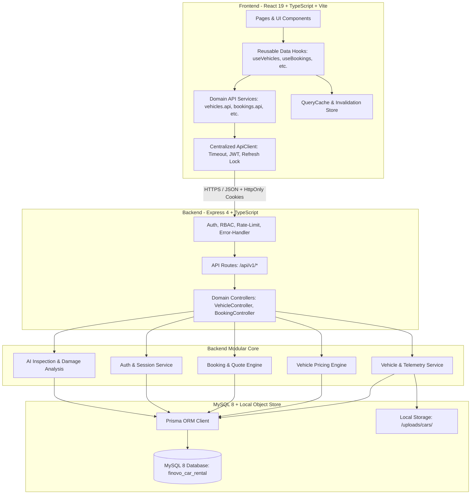

# Finovo AI Car Rental — System Architecture Overview

**Document Version:** 1.0.0  
**Status:** Approved & Implemented  
**Date:** 2026-10-18  

---

## 1. System Vision & Architecture Principles

Finovo AI Car Rental is an enterprise-grade, full-stack vehicle rental and fleet management platform engineered for luxury vehicle hire, real-time booking quotes, operational fleet telemetry, and AI-assisted computer vision damage inspection.

### Architectural Philosophy:
1. **Single Source of Truth on Server:** Business calculations (availability conflicts, hourly/daily tier rates, dynamic quotes, damage liability, tax calculations, and status state machines) are authored and validated strictly on the backend. The frontend provides real-time client previews, but the backend is the authoritative pricing and authorization engine.
2. **Decoupled Deployment Monorepo:** The backend (`backend/`) and frontend (`Frontend/`) are decoupled, independently testable, and independently deployable services sharing clear JSON HTTP contracts.
3. **Layered Frontend Architecture:** Clean separation of concerns:
   $$\text{Pages / UI Components} \longrightarrow \text{Reusable Data Hooks} \longrightarrow \text{Domain API Services} \longrightarrow \text{Centralized HTTP Client} \longrightarrow \text{Backend API}$$
4. **Resilient Data Fetching & Caching:** In-memory reactive caching with automatic query invalidation upon mutations prevents unnecessary network requests and stale UI representations.
5. **Zero Trust Security:** Strict cookie credentials (`SameSite`, `HttpOnly`), rotating short-lived JWT access tokens (15m), Argon2id password hashing, and database-backed session tracking with instant remote revocation.

---

## 2. System Architecture & Boundaries

---

## 3. Frontend / Backend Responsibilities

| Responsibility | Frontend Owner | Backend Owner |
|---|---|---|
| **User Authentication** | `useAuth`, `authApi`, `RoleMiddlewareRoute` | `AuthController`, `AuthService`, Argon2id, JWT issuance |
| **Session Tracking** | Active session viewer & revocation trigger | MySQL `Session` table, IP tracking, token hashing |
| **Fleet Inventory** | `useVehicles`, `CarsDirectoryPage`, `CarDetailPage` | `VehicleController`, `VehicleService`, Prisma queries |
| **Vehicle Pricing** | `useVehiclePricing`, tier configuration UI | `VehiclePricingTier` validation, backend rate calculation |
| **Reservation Quotes** | Real-time quote preview via `bookingsApi.quote` | `BookingService.calculateQuote`, tax, deposit, rate math |
| **Availability Integrity** | `useVehicleAvailability` preview tool | Transaction-level reservation collision check |
| **Damage Inspection** | Multi-angle photo upload & review UI | `InspectionController`, AI confidence scoring |
| **State Caching** | `QueryCache` with key-based mutation invalidation | HTTP Cache headers and database indexing |

---

## 4. End-to-End Request & Data Flow

### Example: Vehicle Pricing Update & Cache Invalidation
1. **User Action:** Staff fleet manager modifies a vehicle's standard daily rate and weekend surge rate on `/admin/cars/:id`.
2. **Hook Execution:** `useVehiclePricing(vehicleId)` calls `createTier` or `updateTier`.
3. **Domain Service:** `vehiclePricingApi.createPricingTier(vehicleId, tierData)` formats the request.
4. **Centralized HTTP Client:** `apiClient.post` attaches `Authorization: Bearer <jwt>`, sets `X-Correlation-Id`, handles timeout, and dispatches the payload.
5. **Backend Guard:** `authenticate` verifies JWT; `requireRole('ADMIN', 'FLEET_MANAGER')` confirms staff permission.
6. **Backend Service:** `VehicleController.createPricingTier` invokes Prisma to create the `VehiclePricingTier` and records a `VehicleAuditLog`.
7. **Response:** 201 Created with persisted pricing tier.
8. **Reactive Invalidation:** `queryCache.invalidateQueries('pricing:<vehicleId>')`, `queryCache.invalidateQueries('vehicles')`, and `queryCache.invalidateQueries('dashboard')`.
9. **UI Auto-Update:** Both the vehicle details page, the fleet listing cards, and the dashboard metrics re-fetch in the background without a full page reload.
